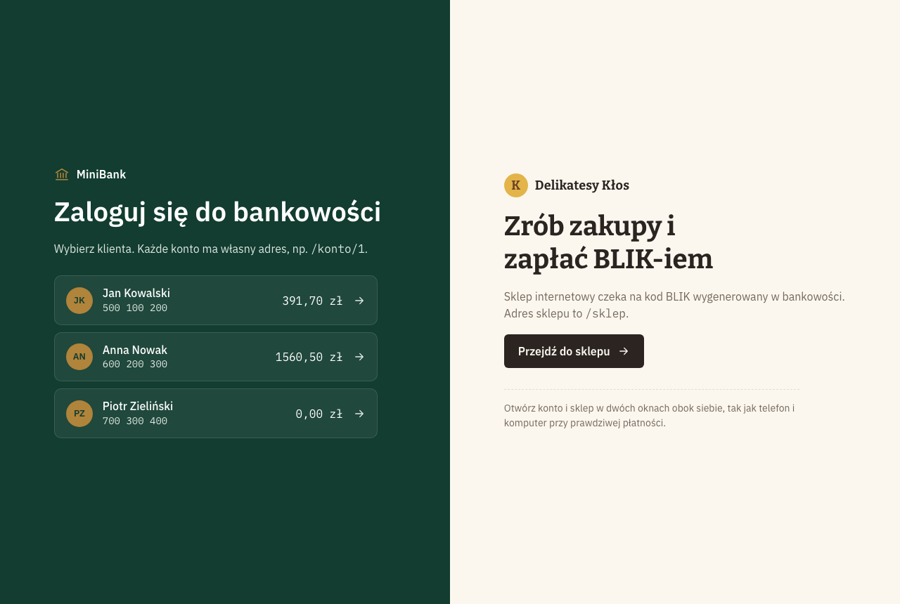
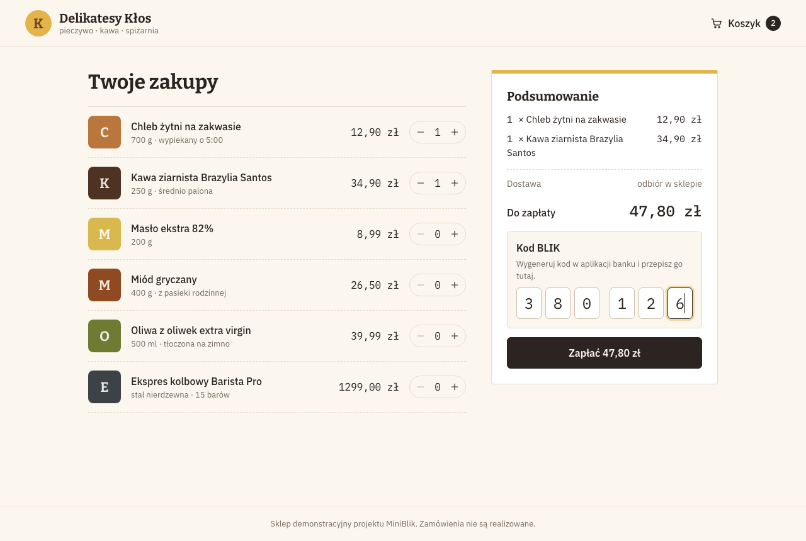
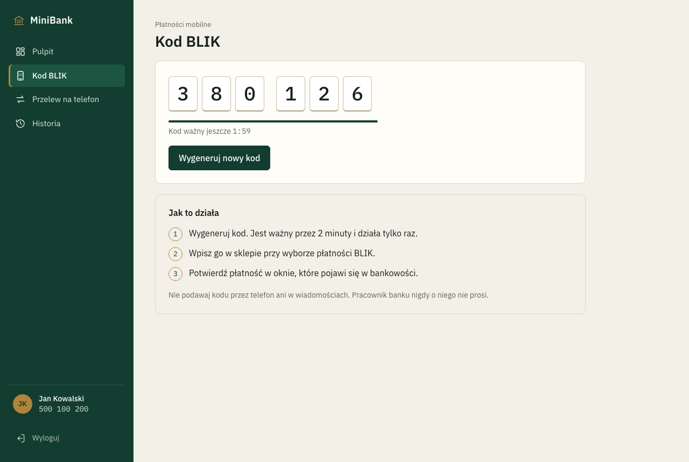
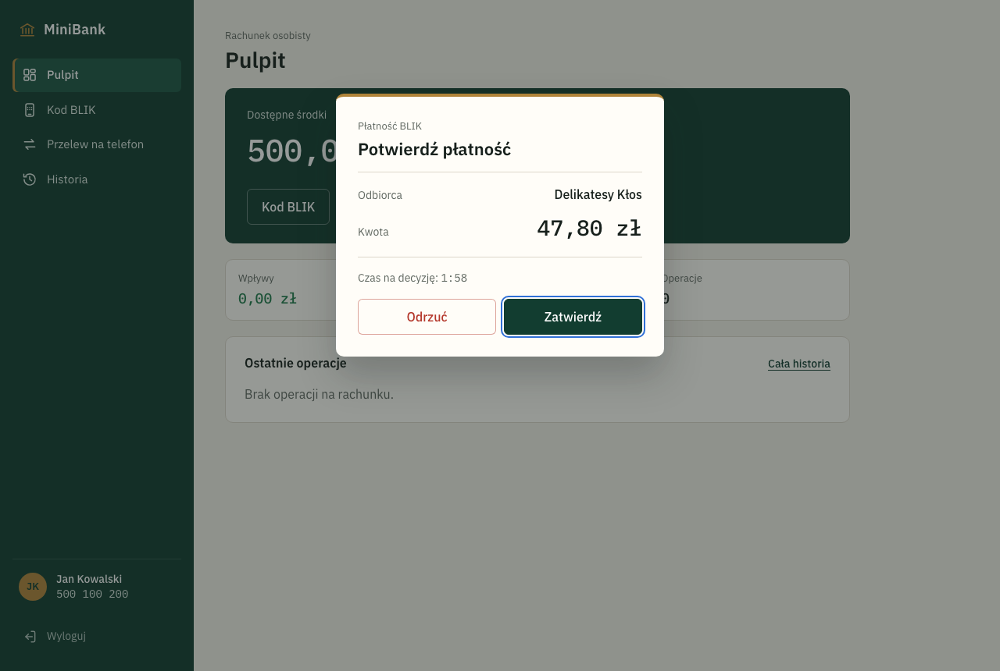
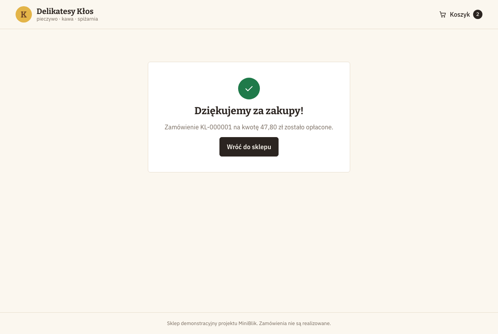
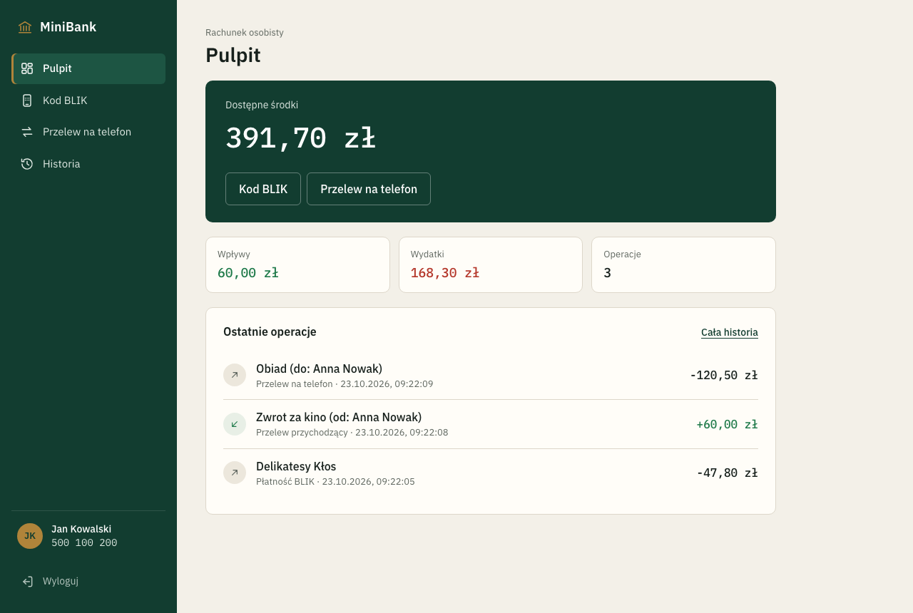
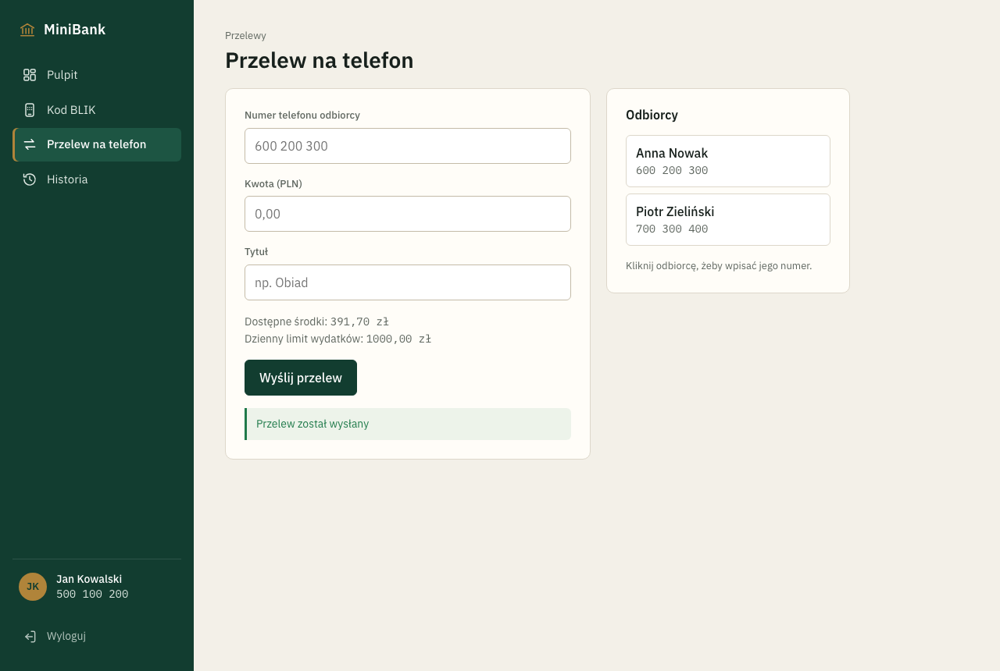
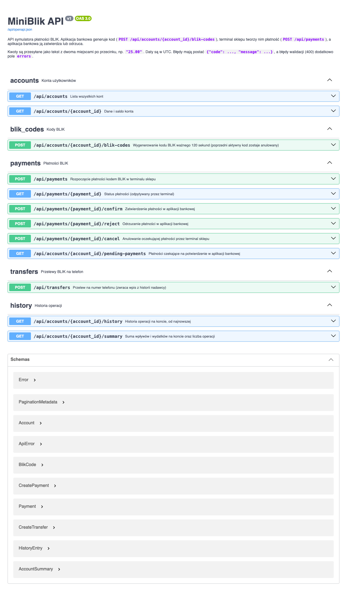

# MiniBlik – symulator płatności BLIK

[](https://github.com/Onyy03/tijo/actions/workflows/ci.yml)

## Nazwa kursu

Testowanie i Jakość Oprogramowania II. Akademia Tarnowska, Wydział Politechniczny, Katedra Informatyki,
rok 4, semestr zimowy 2026/2027.

## Autor

Norbert Armatys, nr indeksu 37664, grupa PT2

## Temat projektu

MiniBlik – symulator płatności kodem BLIK

## Opis projektu

MiniBlik odtwarza w uproszczeniu płatność kodem BLIK. Użytkownik generuje w aplikacji bankowej
6-cyfrowy kod, wpisuje go w sklepie internetowym, a potem zatwierdza albo odrzuca płatność
w bankowości. Oprócz tego można wysłać przelew na numer telefonu, przejrzeć historię operacji
i podsumowanie wpływów oraz wydatków.

Aplikacja ma dwie części z osobnymi adresami. Najwygodniej otworzyć je w dwóch oknach obok siebie:

| Adres | Strona | Co można zrobić |
|---|---|---|
| `/` | strona startowa | wybrać klienta banku albo przejść do sklepu |
| `/konto/{id}` | **MiniBank**, pulpit | saldo, suma wpływów i wydatków, ostatnie operacje |
| `/konto/{id}/blik` | MiniBank, zakładka „Kod BLIK” | wygenerować kod ważny 2 minuty |
| `/konto/{id}/przelew` | MiniBank, zakładka „Przelew na telefon” | wysłać przelew na numer telefonu, także zapisany ze spacjami lub z prefiksem +48 |
| `/konto/{id}/historia` | MiniBank, zakładka „Historia” | przejrzeć operacje z filtrem: wszystkie, wpływy, wydatki |
| `/sklep` | **Delikatesy Kłos**, fikcyjny sklep internetowy | złożyć koszyk, zapłacić kodem BLIK, anulować oczekującą płatność |

Gdy sklep wyśle płatność, w bankowości na każdej zakładce pojawia się okno „Potwierdź płatność”
z odbiorcą, kwotą i czasem na decyzję.

### Reguły biznesowe

| ID | Reguła |
|---|---|
| R1 | Kod ma dokładnie 6 cyfr i jest losowany kryptograficznie bezpiecznym generatorem (`secrets`). |
| R2 | Kod jest ważny 120 sekund od wygenerowania. |
| R3 | Konto ma najwyżej jeden aktywny kod. Wygenerowanie nowego kodu anuluje poprzedni. |
| R4 | Kod jest jednorazowy. Po użyciu w terminalu nie da się nim zapłacić drugi raz. |
| R5 | Kwota musi być większa od zera, mieć najwyżej 2 miejsca po przecinku i nie przekraczać 5 000,00 PLN. |
| R6 | Płatność czeka na potwierdzenie najwyżej 120 sekund. Po tym czasie nie da się jej zatwierdzić. |
| R7 | Zatwierdzenie wymaga wystarczających środków. Przy ich braku saldo się nie zmienia, a płatność dalej czeka. |
| R8 | Zatwierdzić lub odrzucić można tylko płatność, która czeka na decyzję. |
| R9 | Przelew wymaga istniejącego odbiorcy i wystarczających środków. Nie można wysłać przelewu na własny numer. Kwota według R5. |
| R10 | Każda zmiana salda dodaje wpis do historii operacji. |
| R11 | Numer telefonu odbiorcy można podać ze spacjami, myślnikami i prefiksem +48 lub 0048. Po usunięciu tych znaków musi zostać 9 cyfr. |
| R12 | Wydatki z konta (zatwierdzone płatności i przelewy wychodzące) w jednym dniu (UTC) nie mogą przekroczyć 1 000,00 PLN. Wpływy się nie liczą. |
| R13 | Sklep może anulować płatność, która czeka na decyzję. Anulowanej płatności nie da się już zatwierdzić. |
| R14 | Podsumowanie konta pokazuje sumę wpływów, sumę wydatków i liczbę operacji z historii. |

### Konta demonstracyjne

Przy pierwszym uruchomieniu tworzą się konta demonstracyjne:

| Właściciel | Telefon | Saldo |
|---|---|---|
| Jan Kowalski | 500100200 | 500,00 PLN |
| Anna Nowak | 600200300 | 1 500,00 PLN |
| Piotr Zieliński | 700300400 | 0,00 PLN |

### Zrzuty ekranu

Strona startowa z wyborem klienta i sklepu:



Sklep z koszykiem i polem na kod BLIK:



Bankowość: wygenerowany kod BLIK:



Bankowość: prośba o potwierdzenie płatności ze sklepu:



Sklep po zatwierdzeniu płatności w banku:



Bankowość: pulpit po płatności i przelewach:



Bankowość: przelew na telefon:



## Uruchomienie projektu

Wymagania: Python 3.12+ i Node.js 22+.

Backend (API na porcie 5001):

```bash
cd backend
python3 -m venv .venv
source .venv/bin/activate
pip install -r requirements-dev.txt
flask --app app run --port 5001
```

Frontend (w drugim terminalu):

```bash
cd frontend
npm install
npm run dev
```

| Adres | Co jest pod nim |
|---|---|
| http://localhost:5173 | strona startowa (wybór klienta lub sklepu) |
| http://localhost:5173/konto/1 | bankowość Jana Kowalskiego (`/konto/2`, `/konto/3` dla pozostałych) |
| http://localhost:5173/sklep | sklep internetowy |
| http://localhost:5001/api/docs | dokumentacja API (Swagger UI) |

Baza SQLite leży w `backend/instance/miniblik.db`. Żeby wrócić do danych startowych, usuń ten plik
i uruchom backend ponownie.

## Testy

Testy backendu są w katalogu [`backend/tests`](backend/tests). Razem jest 88 przypadków testowych.
Pokrycie kodu **testami jednostkowymi** wynosi 88% przy wymaganym minimum 80%. Testy integracyjne
sprawdzają dodatkowo endpointy i bazę danych, ale nie są wliczane do tej miary.

| Rodzaj | Liczba | Katalog | Co sprawdzają |
|---|---|---|---|
| Jednostkowe | 63 przypadki (45 funkcji testowych, część z kilkoma zestawami danych) | [`backend/tests/unit`](backend/tests/unit) | Logikę domeny i serwisów w izolacji, bez Flaska i bazy danych. Zależności zastępują fałszywe repozytoria, stały zegar i generator kodów z listy ([`tests/fakes.py`](backend/tests/fakes.py)). |
| Integracyjne | 25 | [`backend/tests/integration`](backend/tests/integration) | Całe API przez klienta testowego Flaska, z prawdziwą bazą SQLite w pamięci. Każdy test dostaje świeżą aplikację z kontami demonstracyjnymi. Upływ czasu symuluje zegar, który można przesuwać ([`conftest.py`](backend/tests/integration/conftest.py)). |

### Konwencja

- Każdy test ma budowę **Given-When-Then**: sekcje `# given`, `# when`, `# then`.
- Nazwa testu ma postać `test_should_<oczekiwany efekt>_when_<warunek>`.
- Logika domeny powstawała metodą TDD. W historii commitów test (`test(...)`) jest przed kodem, który
  go spełnia (`feat(...)`). Funkcje R11–R14 powstały w pełnych cyklach **red → green → refactor**:
  1. 🔴 commit z testem, który jeszcze nie przechodzi,
  2. 🟢 commit z najprostszym kodem, po którym test przechodzi,
  3. 🔵 commit z uporządkowaniem kodu przy zielonych testach.

  Przykład z historii: `a100f61 test(transfer)` → `0883d4f feat(transfer)` → `358c594 refactor(transfer)`.

```python
def test_should_reject_withdrawal_when_balance_is_insufficient():
    # given
    account = create_account(balance_cents=1000)

    # when
    with pytest.raises(BusinessError) as error:
        account.withdraw(2500)

    # then
    assert error.value.code == ErrorCode.INSUFFICIENT_FUNDS
    assert account.balance_cents == 1000
```

### Uruchamianie

```bash
cd backend
source .venv/bin/activate
pytest                     # wszystkie testy
pytest tests/unit --cov    # testy jednostkowe z raportem pokrycia (wymagane minimum 80%)
pytest tests/integration   # testy integracyjne
```

Te same polecenia uruchamia GitHub Actions ([`.github/workflows/ci.yml`](.github/workflows/ci.yml))
przy każdym pushu na `main` i `develop` oraz przy każdym pull requeście.

### Testy jednostkowe

Kody BLIK: [`test_code_generator.py`](backend/tests/unit/test_code_generator.py),
[`test_blik_code.py`](backend/tests/unit/test_blik_code.py),
[`test_blik_code_service.py`](backend/tests/unit/test_blik_code_service.py)

- [`test_should_generate_code_made_of_exactly_six_digits`](backend/tests/unit/test_code_generator.py#L8): generator zawsze zwraca 6 cyfr (100 losowań).
- [`test_should_be_active_before_lifetime_passes`](backend/tests/unit/test_blik_code.py#L8): kod jest aktywny 119 s po wygenerowaniu.
- [`test_should_be_inactive_after_lifetime_passes`](backend/tests/unit/test_blik_code.py#L19): po 120 s kod jest nieaktywny.
- [`test_should_be_inactive_when_cancelled`](backend/tests/unit/test_blik_code.py#L30): anulowany kod jest nieaktywny.
- [`test_should_set_expiry_to_120_seconds_after_generation`](backend/tests/unit/test_blik_code_service.py#L30): nowy kod jest ważny do „teraz + 120 s” i trafia do repozytorium.
- [`test_should_cancel_previous_active_code_when_generating_new_one`](backend/tests/unit/test_blik_code_service.py#L44): nowy kod anuluje poprzedni.
- [`test_should_draw_again_when_generated_code_is_already_in_use`](backend/tests/unit/test_blik_code_service.py#L56): kod zajęty przez inne konto jest losowany ponownie.
- [`test_should_give_up_when_every_drawn_code_is_already_in_use`](backend/tests/unit/test_blik_code_service.py#L69): po wyczerpaniu prób serwis zgłasza błąd i nic nie zapisuje.

Konto i kwoty: [`test_account.py`](backend/tests/unit/test_account.py),
[`test_amount_validator.py`](backend/tests/unit/test_amount_validator.py)

- [`test_should_decrease_balance_when_withdrawing_available_funds`](backend/tests/unit/test_account.py#L11): wypłata zmniejsza saldo.
- [`test_should_reject_withdrawal_when_balance_is_insufficient`](backend/tests/unit/test_account.py#L22): brak środków daje błąd `INSUFFICIENT_FUNDS`, a saldo się nie zmienia.
- [`test_should_reject_amount_when_it_is_not_positive`](backend/tests/unit/test_amount_validator.py#L21): kwoty `0`, `0.00` i `-5` są odrzucane.
- [`test_should_reject_amount_when_it_exceeds_limit`](backend/tests/unit/test_amount_validator.py#L33): kwota `5000.01` przekracza limit.
- [`test_should_reject_amount_when_it_has_more_than_two_decimal_places`](backend/tests/unit/test_amount_validator.py#L45): kwota `10.555` ma za dużo miejsc po przecinku.
- [`test_should_accept_amount_when_all_rules_pass`](backend/tests/unit/test_amount_validator.py#L58): kwoty `0.01`, `25.50`, `1.500` i `5000.00` przechodzą wszystkie reguły.

Płatności: [`test_payment_service.py`](backend/tests/unit/test_payment_service.py)

- [`test_should_create_pending_payment_and_mark_code_as_used_when_code_is_active`](backend/tests/unit/test_payment_service.py#L67): płatność czeka na decyzję, a kod jest oznaczony jako zużyty.
- [`test_should_reject_payment_when_code_does_not_exist`](backend/tests/unit/test_payment_service.py#L85): nieznany kod daje błąd `CODE_NOT_FOUND`.
- [`test_should_reject_payment_when_code_has_expired`](backend/tests/unit/test_payment_service.py#L97): kod starszy niż 120 s daje błąd `CODE_EXPIRED`.
- [`test_should_reject_payment_when_code_was_already_used`](backend/tests/unit/test_payment_service.py#L110): drugie użycie kodu daje błąd `CODE_NOT_ACTIVE`.
- [`test_should_keep_code_active_when_amount_is_invalid`](backend/tests/unit/test_payment_service.py#L123): błędna kwota nie zużywa kodu.
- [`test_should_withdraw_funds_and_record_history_when_payment_is_confirmed`](backend/tests/unit/test_payment_service.py#L136): zatwierdzenie pobiera środki i dodaje wpis do historii.
- [`test_should_keep_balance_and_pending_status_when_funds_are_insufficient`](backend/tests/unit/test_payment_service.py#L155): przy braku środków saldo i status płatności się nie zmieniają.
- [`test_should_reject_confirmation_when_payment_has_expired`](backend/tests/unit/test_payment_service.py#L173): po 120 s płatności nie da się zatwierdzić (`PAYMENT_EXPIRED`).
- [`test_should_mark_payment_as_rejected_without_charging_account`](backend/tests/unit/test_payment_service.py#L188): odrzucenie nie zmienia salda.
- [`test_should_reject_decision_when_payment_is_not_pending`](backend/tests/unit/test_payment_service.py#L201): rozliczonej płatności nie da się ponownie zatwierdzić, odrzucić ani anulować.
- [`test_should_raise_not_found_when_confirming_unknown_payment`](backend/tests/unit/test_payment_service.py#L214): nieznana płatność daje błąd `PAYMENT_NOT_FOUND`.
- [`test_should_reject_confirmation_when_daily_spending_limit_would_be_exceeded`](backend/tests/unit/test_payment_service.py#L226): zatwierdzenie ponad dzienny limit daje błąd `DAILY_LIMIT_EXCEEDED`, a saldo i status płatności się nie zmieniają.
- [`test_should_mark_payment_as_cancelled_when_merchant_cancels_it`](backend/tests/unit/test_payment_service.py#L252): anulowanie przez sklep ustawia status `CANCELLED` i nie zmienia salda.

Przelewy: [`test_transfer_service.py`](backend/tests/unit/test_transfer_service.py)

- [`test_should_move_funds_and_record_both_history_entries_when_transfer_succeeds`](backend/tests/unit/test_transfer_service.py#L49): przelew zmienia oba salda i dodaje wpis w historii każdego z kont.
- [`test_should_reject_transfer_when_recipient_is_sender`](backend/tests/unit/test_transfer_service.py#L74): przelew na własny numer daje błąd `SELF_TRANSFER`.
- [`test_should_reject_transfer_when_recipient_does_not_exist`](backend/tests/unit/test_transfer_service.py#L87): nieznany numer daje błąd `RECIPIENT_NOT_FOUND`.
- [`test_should_keep_both_balances_when_sender_has_insufficient_funds`](backend/tests/unit/test_transfer_service.py#L100): przy braku środków nie zmienia się żadne saldo.
- [`test_should_reject_transfer_when_amount_is_invalid`](backend/tests/unit/test_transfer_service.py#L117): ujemna kwota jest odrzucana.
- [`test_should_reject_transfer_when_daily_spending_limit_would_be_exceeded`](backend/tests/unit/test_transfer_service.py#L141): przelew ponad dzienny limit daje błąd `DAILY_LIMIT_EXCEEDED`, a żadne saldo się nie zmienia.
- [`test_should_allow_transfer_that_reaches_daily_limit_exactly`](backend/tests/unit/test_transfer_service.py#L159): wydatki równe dokładnie 1 000,00 zł są dozwolone.
- [`test_should_not_count_spending_from_previous_day_towards_daily_limit`](backend/tests/unit/test_transfer_service.py#L171): wczorajsze wydatki nie liczą się do dzisiejszego limitu.
- [`test_should_not_count_incoming_money_towards_daily_limit`](backend/tests/unit/test_transfer_service.py#L184): wpływy nie liczą się do limitu.

Numer telefonu: [`test_phone_number.py`](backend/tests/unit/test_phone_number.py)

- [`test_should_return_nine_digits_when_number_is_written_in_common_format`](backend/tests/unit/test_phone_number.py#L17): zapisy „600 200 300”, „600-200-300”, „+48 600 200 300” i „0048600200300” dają „600200300”.
- [`test_should_reject_number_when_it_is_not_a_nine_digit_polish_number`](backend/tests/unit/test_phone_number.py#L29): numer za krótki, za długi, z literą albo z innym prefiksem kraju jest odrzucany.

Podsumowanie konta: [`test_history_service.py`](backend/tests/unit/test_history_service.py)

- [`test_should_sum_incoming_and_outgoing_money_separately`](backend/tests/unit/test_history_service.py#L40): wpływy i wydatki są liczone osobno, a operacje innych kont pomijane.
- [`test_should_return_zeros_when_account_has_no_operations`](backend/tests/unit/test_history_service.py#L56): konto bez operacji ma podsumowanie złożone z zer.
- [`test_should_raise_not_found_when_summarizing_unknown_account`](backend/tests/unit/test_history_service.py#L67): nieznane konto daje błąd `ACCOUNT_NOT_FOUND`.

Pomocnicze: [`test_fields.py`](backend/tests/unit/test_fields.py),
[`test_clock.py`](backend/tests/unit/test_clock.py)

- [`test_should_serialize_cents_as_decimal_string`](backend/tests/unit/test_fields.py#L17): grosze są zamieniane na tekst w API (`2500` → `"25.00"`).
- [`test_should_add_utc_offset_to_datetime_from_database`](backend/tests/unit/test_fields.py#L28): daty z bazy dostają strefę UTC.
- [`test_should_keep_missing_values_empty`](backend/tests/unit/test_fields.py#L39): pusta wartość zostaje pusta.
- [`test_should_return_current_utc_time_without_timezone`](backend/tests/unit/test_clock.py#L6): zegar systemowy zwraca bieżący czas UTC.

### Testy integracyjne

Konta: [`test_accounts_api.py`](backend/tests/integration/test_accounts_api.py),
[`test_seed.py`](backend/tests/integration/test_seed.py)

- [`test_should_return_demo_accounts_when_listing_accounts`](backend/tests/integration/test_accounts_api.py#L1): `GET /api/accounts` zwraca 200 i trzy konta demonstracyjne.
- [`test_should_return_not_found_when_account_does_not_exist`](backend/tests/integration/test_accounts_api.py#L20): `GET /api/accounts/999` zwraca 404 `ACCOUNT_NOT_FOUND`.
- [`test_should_not_duplicate_demo_accounts_when_seeding_again`](backend/tests/integration/test_seed.py#L8): ponowne tworzenie danych demonstracyjnych nie dubluje kont.

Kody BLIK: [`test_blik_codes_api.py`](backend/tests/integration/test_blik_codes_api.py)

- [`test_should_create_active_six_digit_code_valid_for_120_seconds`](backend/tests/integration/test_blik_codes_api.py#L16): `POST /api/accounts/1/blik-codes` zwraca 201, 6-cyfrowy kod i datę ważności. W bazie kod ma status `ACTIVE`.
- [`test_should_cancel_previous_code_when_generating_new_one`](backend/tests/integration/test_blik_codes_api.py#L31): po wygenerowaniu drugiego kodu pierwszy ma w bazie status `CANCELLED`.

Płatności: [`test_payments_api.py`](backend/tests/integration/test_payments_api.py)

- [`test_should_create_pending_payment_when_code_is_valid`](backend/tests/integration/test_payments_api.py#L13): `POST /api/payments` zwraca 201 i status `PENDING`.
- [`test_should_return_bad_request_when_code_format_is_invalid`](backend/tests/integration/test_payments_api.py#L26): kod `12ab56` daje 400 `VALIDATION_ERROR` z komunikatem przy polu.
- [`test_should_return_not_found_when_code_does_not_exist`](backend/tests/integration/test_payments_api.py#L40): nieznany kod daje 404 `CODE_NOT_FOUND`.
- [`test_should_reject_payment_when_code_has_expired`](backend/tests/integration/test_payments_api.py#L52): po przesunięciu zegara o 121 s odpowiedź to 422 `CODE_EXPIRED`.
- [`test_should_reject_second_payment_with_the_same_code`](backend/tests/integration/test_payments_api.py#L65): drugie użycie kodu daje 422 `CODE_NOT_ACTIVE`.
- [`test_should_list_new_payment_as_pending_only_for_code_owner`](backend/tests/integration/test_payments_api.py#L78): płatność widzi do potwierdzenia tylko właściciel kodu.
- [`test_should_charge_account_and_record_history_when_payment_is_confirmed`](backend/tests/integration/test_payments_api.py#L91): zatwierdzenie zwraca 200, saldo spada do 475,00 PLN, a w historii jest nowy wpis.
- [`test_should_keep_balance_when_confirming_without_sufficient_funds`](backend/tests/integration/test_payments_api.py#L107): brak środków daje 422 `INSUFFICIENT_FUNDS`, a saldo i status płatności się nie zmieniają.
- [`test_should_mark_payment_as_rejected_without_charging_account`](backend/tests/integration/test_payments_api.py#L121): odrzucenie zwraca 200 `REJECTED` i nie zmienia salda.
- [`test_should_refuse_confirmation_when_payment_has_expired`](backend/tests/integration/test_payments_api.py#L135): po 121 s odpowiedź to 422 `PAYMENT_EXPIRED`, a płatność znika z listy do potwierdzenia.
- [`test_should_cancel_pending_payment_from_terminal`](backend/tests/integration/test_payments_api.py#L150): `POST /api/payments/{id}/cancel` zwraca 200 `CANCELLED`, płatność znika z listy do potwierdzenia i nie da się jej już zatwierdzić.

Przelewy i historia: [`test_transfers_api.py`](backend/tests/integration/test_transfers_api.py)

- [`test_should_move_funds_between_accounts_when_transfer_is_valid`](backend/tests/integration/test_transfers_api.py#L24): `POST /api/transfers` zwraca 201, a salda wynoszą 380,00 i 1 620,00 PLN.
- [`test_should_return_not_found_when_recipient_phone_is_unknown`](backend/tests/integration/test_transfers_api.py#L39): nieznany numer daje 404 `RECIPIENT_NOT_FOUND`.
- [`test_should_show_transfer_in_history_of_both_accounts`](backend/tests/integration/test_transfers_api.py#L52): przelew widać w historii nadawcy i odbiorcy.
- [`test_should_accept_recipient_phone_written_with_spaces_and_country_prefix`](backend/tests/integration/test_transfers_api.py#L69): przelew na „+48 600 200 300” trafia do Anny Nowak.
- [`test_should_reject_transfer_when_daily_spending_limit_is_exceeded`](backend/tests/integration/test_transfers_api.py#L81): po przelewie 600 zł kolejny na 500 zł daje 422 `DAILY_LIMIT_EXCEEDED`.

Podsumowanie konta: [`test_summary_api.py`](backend/tests/integration/test_summary_api.py)

- [`test_should_summarize_money_coming_in_and_out_of_account`](backend/tests/integration/test_summary_api.py#L4): `GET /api/accounts/1/summary` po płatności i wpływie zwraca sumy 100,00 i 25,00 zł oraz 2 operacje.
- [`test_should_return_not_found_for_summary_of_unknown_account`](backend/tests/integration/test_summary_api.py#L30): nieznane konto daje 404 `ACCOUNT_NOT_FOUND`.

Dokumentacja API: [`test_openapi.py`](backend/tests/integration/test_openapi.py)

- [`test_should_publish_openapi_specification_with_all_resources`](backend/tests/integration/test_openapi.py#L1): `/api/openapi.json` zawiera wszystkie zasoby.
- [`test_should_serve_swagger_ui_page`](backend/tests/integration/test_openapi.py#L22): strona Swagger UI odpowiada pod `/api/docs`.

### Analiza statyczna kodu

```bash
cd backend && ruff check . && ruff format --check .   # m.in. nieużywane importy (F401) i nazewnictwo (N)
cd frontend && npm run lint                           # oxlint, m.in. nieużywane zmienne i importy
```

## Dokumentacja API

Dokumentację API w standardzie **OpenAPI 3** generuje biblioteka flask-smorest prosto z kodu: z tras,
schematów marshmallow i docstringów. Dzięki temu dokumentacja nie rozjeżdża się z implementacją.

| Co | Gdzie |
|---|---|
| Swagger UI (można z niego wysyłać zapytania) | http://localhost:5001/api/docs (po uruchomieniu backendu) |
| Specyfikacja OpenAPI (JSON) | http://localhost:5001/api/openapi.json |
| Kopia specyfikacji w repozytorium | [`docs/openapi.json`](docs/openapi.json) |

Kopię specyfikacji odświeża polecenie `cd backend && flask --app app openapi write ../docs/openapi.json`.



### Endpointy

| Metoda | Ścieżka | Kto używa | Opis | Odpowiedzi |
|---|---|---|---|---|
| GET | `/api/accounts` | aplikacja bankowa | lista kont | 200 |
| GET | `/api/accounts/{account_id}` | aplikacja bankowa | dane i saldo konta | 200, 404 |
| POST | `/api/accounts/{account_id}/blik-codes` | aplikacja bankowa | wygenerowanie kodu BLIK (poprzedni aktywny kod zostaje anulowany) | 201, 404 |
| GET | `/api/accounts/{account_id}/pending-payments` | aplikacja bankowa | płatności czekające na potwierdzenie | 200, 404 |
| GET | `/api/accounts/{account_id}/history` | aplikacja bankowa | historia operacji, od najnowszej | 200, 404 |
| GET | `/api/accounts/{account_id}/summary` | aplikacja bankowa | suma wpływów i wydatków, liczba operacji | 200, 404 |
| POST | `/api/payments` | terminal sklepu | rozpoczęcie płatności kodem BLIK | 201, 400, 404, 422 |
| GET | `/api/payments/{payment_id}` | terminal sklepu | status płatności | 200, 404 |
| POST | `/api/payments/{payment_id}/confirm` | aplikacja bankowa | zatwierdzenie płatności | 200, 404, 422 |
| POST | `/api/payments/{payment_id}/reject` | aplikacja bankowa | odrzucenie płatności | 200, 404, 422 |
| POST | `/api/payments/{payment_id}/cancel` | terminal sklepu | anulowanie oczekującej płatności | 200, 404, 422 |
| POST | `/api/transfers` | aplikacja bankowa | przelew na numer telefonu | 201, 400, 404, 422 |

Kwoty są przesyłane jako tekst z dwoma miejscami po przecinku (`"25.00"`), a daty w formacie ISO 8601
w UTC.

### Błędy

Każdy błąd ma ten sam format. Błędy walidacji (400) mają dodatkowo pole `errors` z komunikatami dla
poszczególnych pól.

```json
{
  "code": "PAYMENT_NOT_PENDING",
  "message": "Płatność została już rozliczona"
}
```

| HTTP | `code` | Kiedy |
|---|---|---|
| 400 | `VALIDATION_ERROR` | niepoprawne dane wejściowe, np. kod nie ma 6 cyfr, kwota nie jest liczbą albo numer telefonu nie ma 9 cyfr |
| 404 | `ACCOUNT_NOT_FOUND`, `CODE_NOT_FOUND`, `PAYMENT_NOT_FOUND`, `RECIPIENT_NOT_FOUND` | brak konta, kodu, płatności albo odbiorcy o podanym numerze |
| 422 | `CODE_EXPIRED`, `CODE_NOT_ACTIVE` | kod wygasł albo został już użyty lub anulowany |
| 422 | `INVALID_AMOUNT`, `AMOUNT_LIMIT_EXCEEDED` | kwota nie jest dodatnia, ma więcej niż 2 miejsca po przecinku albo przekracza 5 000,00 PLN |
| 422 | `INSUFFICIENT_FUNDS` | za mało środków na koncie |
| 422 | `DAILY_LIMIT_EXCEEDED` | operacja przekroczyłaby dzienny limit wydatków 1 000,00 PLN |
| 422 | `PAYMENT_EXPIRED`, `PAYMENT_NOT_PENDING` | minął czas na potwierdzenie albo płatność jest już rozliczona |
| 422 | `SELF_TRANSFER` | przelew na własny numer telefonu |

### Przykłady

Pełny przebieg płatności i przelewu na świeżej bazie. Odpowiedzi są sformatowane dla czytelności.

```bash
# 1. Aplikacja bankowa generuje kod dla konta Jana Kowalskiego
curl -X POST http://localhost:5001/api/accounts/1/blik-codes
```
```json
{ "code": "411609", "expires_at": "2026-10-20T22:23:37.273595+00:00" }
```

```bash
# 2. Terminal sklepu rozpoczyna płatność tym kodem
curl -X POST http://localhost:5001/api/payments \
  -H 'Content-Type: application/json' \
  -d '{"code": "411609", "amount": "25.00", "merchant_name": "Żabka"}'
```
```json
{
  "id": 1,
  "merchant_name": "Żabka",
  "amount": "25.00",
  "status": "PENDING",
  "created_at": "2026-10-20T22:21:37.304090+00:00",
  "expires_at": "2026-10-20T22:23:37.304090+00:00"
}
```

```bash
# 3. Aplikacja bankowa zatwierdza płatność (status zmienia się na CONFIRMED)
curl -X POST http://localhost:5001/api/payments/1/confirm

# 4. Ponowne zatwierdzenie tej samej płatności: HTTP 422
curl -X POST http://localhost:5001/api/payments/1/confirm
```
```json
{ "code": "PAYMENT_NOT_PENDING", "message": "Płatność została już rozliczona" }
```

```bash
# 5. Przelew na telefon Anny Nowak
curl -X POST http://localhost:5001/api/transfers \
  -H 'Content-Type: application/json' \
  -d '{"from_account_id": 1, "to_phone_number": "600200300", "amount": "120.50", "title": "Obiad"}'

# 6. Historia operacji Jana Kowalskiego
curl http://localhost:5001/api/accounts/1/history
```
```json
[
  { "id": 2, "type": "TRANSFER_OUT", "amount": "-120.50", "description": "Obiad (do: Anna Nowak)", "created_at": "2026-10-20T22:21:37.341939+00:00" },
  { "id": 1, "type": "PAYMENT", "amount": "-25.00", "description": "Żabka", "created_at": "2026-10-20T22:21:37.329755+00:00" }
]
```

```bash
# 7. Niepoprawne dane: HTTP 400
curl -X POST http://localhost:5001/api/payments \
  -H 'Content-Type: application/json' \
  -d '{"code": "12ab56", "amount": "abc", "merchant_name": "Żabka"}'
```
```json
{
  "code": "VALIDATION_ERROR",
  "message": "Niepoprawne dane wejściowe",
  "errors": {
    "json": {
      "amount": ["Kwota musi być liczbą"],
      "code": ["Kod BLIK musi mieć 6 cyfr"]
    }
  }
}
```

## Przypadki testowe dla testera manualnego

**Warunki wspólne dla wszystkich przypadków:**
- backend i frontend są uruchomione zgodnie z sekcją [Uruchomienie projektu](#uruchomienie-projektu),
- otwarte są dwa okna przeglądarki obok siebie: bank (np. http://localhost:5173/konto/1) i sklep
  (http://localhost:5173/sklep),
- w sklepie jest koszyk startowy: „Chleb żytni na zakwasie” i „Kawa ziarnista Brazylia Santos”, razem 47,80 zł,
- baza zawiera tylko konta demonstracyjne. Żeby wrócić do tego stanu przed przypadkiem testowym, zatrzymaj
  backend, usuń plik `backend/instance/miniblik.db`, uruchom backend ponownie i odśwież oba okna.

| ID | Tytuł | Sprawdzana reguła |
|---|---|---|
| [TC001](#tc001) | Generowanie kodu BLIK | R1, R2 |
| [TC002](#tc002) | Wygaśnięcie kodu po 2 minutach | R2 |
| [TC003](#tc003) | Nowy kod unieważnia poprzedni | R3 |
| [TC004](#tc004) | Płatność poprawnym kodem BLIK | R4 |
| [TC005](#tc005) | Zatwierdzenie płatności | R7, R10 |
| [TC006](#tc006) | Odrzucenie płatności | R8 |
| [TC007](#tc007) | Płatność nieistniejącym kodem | R1 |
| [TC008](#tc008) | Płatność wygasłym kodem | R2 |
| [TC009](#tc009) | Ponowne użycie wykorzystanego kodu | R4 |
| [TC010](#tc010) | Zatwierdzenie płatności bez wystarczających środków | R7 |
| [TC011](#tc011) | Kwota zamówienia w sklepie | R5 |
| [TC012](#tc012) | Przelew na numer telefonu | R9, R10 |
| [TC013](#tc013) | Przelew na własny i nieistniejący numer | R9 |
| [TC014](#tc014) | Anulowanie płatności przez sklep | R13 |
| [TC015](#tc015) | Przekroczenie dziennego limitu wydatków | R12 |
| [TC016](#tc016) | Przelew na numer zapisany ze spacjami i prefiksem | R11 |
| [TC017](#tc017) | Podsumowanie wpływów i wydatków | R14 |
| [TC018](#tc018) | Strona startowa i adresy kont | interfejs |
| [TC019](#tc019) | Filtr historii operacji | interfejs |

### TC001

| **ID** | TC001 |
|---|---|
| **Tytuł** | Generowanie kodu BLIK |
| **Warunki początkowe** | Warunki wspólne. W oknie banku otwarte jest konto http://localhost:5173/konto/1 (Jan Kowalski). |
| **Kroki testowe** | 1. W menu kliknij **Kod BLIK**.<br>2. Kliknij **Generuj kod BLIK**. |
| **Oczekiwany rezultat** | Adres zmienia się na `/konto/1/blik`. Wyświetla się 6 cyfr w osobnych polach, pasek pozostałego czasu i napis „Kod ważny jeszcze 2:00”, który maleje co sekundę. Przycisk zmienia nazwę na „Wygeneruj nowy kod”. |

### TC002

| **ID** | TC002 |
|---|---|
| **Tytuł** | Wygaśnięcie kodu po 2 minutach |
| **Warunki początkowe** | Wykonany TC001: kod jest widoczny. |
| **Kroki testowe** | 1. Odczekaj 2 minuty bez płacenia kodem. |
| **Oczekiwany rezultat** | Kod znika, a w jego miejscu pojawia się komunikat „Kod BLIK wygasł. Wygeneruj nowy kod.” |

### TC003

| **ID** | TC003 |
|---|---|
| **Tytuł** | Nowy kod unieważnia poprzedni |
| **Warunki początkowe** | Warunki wspólne. W oknie banku otwarta jest zakładka `/konto/1/blik`. |
| **Kroki testowe** | 1. Kliknij **Generuj kod BLIK** i zapisz kod (kod A).<br>2. Kliknij **Wygeneruj nowy kod**.<br>3. W oknie sklepu wpisz kod A i kliknij **Zapłać 47,80 zł**. |
| **Oczekiwany rezultat** | Po kroku 2 widać kod inny niż kod A. Po kroku 3 sklep pokazuje „Kod BLIK został już wykorzystany lub anulowany” i zostaje na koszyku. |

### TC004

| **ID** | TC004 |
|---|---|
| **Tytuł** | Płatność poprawnym kodem BLIK |
| **Warunki początkowe** | Warunki wspólne. Saldo Jana Kowalskiego wynosi 500,00 zł, a koszyk w sklepie 47,80 zł. |
| **Kroki testowe** | 1. W banku na zakładce `/konto/1/blik` kliknij **Generuj kod BLIK** i zapisz kod.<br>2. W sklepie wpisz kod w 6 pól. Można też wkleić wszystkie cyfry naraz.<br>3. Kliknij **Zapłać 47,80 zł**. |
| **Oczekiwany rezultat** | Przed wpisaniem kodu przycisk „Zapłać 47,80 zł” jest nieaktywny. Po kroku 3 sklep pokazuje „Potwierdź płatność w aplikacji banku”, „Zamówienie KL-000001 · 47,80 zł” i pozostały czas. W banku pojawia się okno „Potwierdź płatność” z odbiorcą „Delikatesy Kłos”, kwotą „47,80 zł” i czasem na decyzję. Zakładka „Kod BLIK” pokazuje „Kod został użyty w płatności. Do kolejnej płatności wygeneruj nowy.” |

### TC005

| **ID** | TC005 |
|---|---|
| **Tytuł** | Zatwierdzenie płatności |
| **Warunki początkowe** | Wykonany TC004: okno „Potwierdź płatność” jest otwarte w banku. |
| **Kroki testowe** | 1. W oknie kliknij **Zatwierdź**.<br>2. W menu kliknij **Pulpit**. |
| **Oczekiwany rezultat** | Okno znika. Sklep w ciągu 2 sekund pokazuje „Dziękujemy za zakupy!” i „Zamówienie KL-000001 na kwotę 47,80 zł zostało opłacone.” Na pulpicie saldo wynosi 452,20 zł, a w „Ostatnich operacjach” jest wpis „Delikatesy Kłos, Płatność BLIK, -47,80 zł”. |

### TC006

| **ID** | TC006 |
|---|---|
| **Tytuł** | Odrzucenie płatności |
| **Warunki początkowe** | Wykonany TC004: okno „Potwierdź płatność” jest otwarte w banku. |
| **Kroki testowe** | 1. W oknie kliknij **Odrzuć**. |
| **Oczekiwany rezultat** | Sklep pokazuje „Płatność odrzucona” i „Płatność została odrzucona w aplikacji banku. Zamówienie nie zostało złożone.” Saldo nadal wynosi 500,00 zł, a w historii nie ma nowych operacji. |

### TC007

| **ID** | TC007 |
|---|---|
| **Tytuł** | Płatność nieistniejącym kodem |
| **Warunki początkowe** | Warunki wspólne. Nie wygenerowano żadnego kodu BLIK. |
| **Kroki testowe** | 1. W sklepie wpisz kod **999999**.<br>2. Kliknij **Zapłać 47,80 zł**. |
| **Oczekiwany rezultat** | Sklep pokazuje „Nieprawidłowy kod BLIK”, a pola kodu są wyczyszczone. Koszyk się nie zmienia i płatność nie powstaje. |

### TC008

| **ID** | TC008 |
|---|---|
| **Tytuł** | Płatność wygasłym kodem |
| **Warunki początkowe** | Warunki wspólne. W oknie banku otwarta jest zakładka `/konto/1/blik`. |
| **Kroki testowe** | 1. Kliknij **Generuj kod BLIK** i zapisz kod.<br>2. Odczekaj ponad 2 minuty.<br>3. W sklepie wpisz zapisany kod i kliknij **Zapłać 47,80 zł**. |
| **Oczekiwany rezultat** | Sklep pokazuje „Kod BLIK wygasł”, a płatność nie powstaje. |

### TC009

| **ID** | TC009 |
|---|---|
| **Tytuł** | Ponowne użycie wykorzystanego kodu |
| **Warunki początkowe** | Wykonany TC005: sklep pokazuje „Dziękujemy za zakupy!”. |
| **Kroki testowe** | 1. W sklepie kliknij **Wróć do sklepu**.<br>2. Wpisz ten sam kod, którym zapłacono w TC004.<br>3. Kliknij **Zapłać 47,80 zł**. |
| **Oczekiwany rezultat** | Sklep pokazuje „Kod BLIK został już wykorzystany lub anulowany”, a druga płatność nie powstaje. |

### TC010

| **ID** | TC010 |
|---|---|
| **Tytuł** | Zatwierdzenie płatności bez wystarczających środków |
| **Warunki początkowe** | Warunki wspólne. W oknie banku otwarte jest konto `/konto/3` (Piotr Zieliński, saldo 0,00 zł). |
| **Kroki testowe** | 1. W menu kliknij **Kod BLIK**, a potem **Generuj kod BLIK**.<br>2. W sklepie wpisz kod i kliknij **Zapłać 47,80 zł**.<br>3. W oknie „Potwierdź płatność” w banku kliknij **Zatwierdź**.<br>4. Kliknij **Odrzuć**. |
| **Oczekiwany rezultat** | Po kroku 3 w oknie pojawia się „Niewystarczające środki na koncie”, a okno zostaje otwarte. Saldo nadal wynosi 0,00 zł. Po kroku 4 sklep pokazuje „Płatność odrzucona”. |

### TC011

| **ID** | TC011 |
|---|---|
| **Tytuł** | Kwota zamówienia w sklepie |
| **Warunki początkowe** | Warunki wspólne. W oknie banku otwarta jest zakładka `/konto/1/blik`. |
| **Kroki testowe** | 1. W sklepie usuń przyciskiem **−** chleb i kawę.<br>2. Kliknij 4 razy **+** przy „Ekspres kolbowy Barista Pro”.<br>3. W banku kliknij **Generuj kod BLIK**, wpisz kod w sklepie i kliknij **Zapłać 5196,00 zł**.<br>4. Usuń wszystkie ekspresy, dodaj jeden chleb, wpisz ten sam kod jeszcze raz i kliknij **Zapłać 12,90 zł**. |
| **Oczekiwany rezultat** | Po kroku 1 sklep pokazuje „Koszyk jest pusty. Dodaj produkty, żeby złożyć zamówienie.”, a przycisk „Zapłać 0,00 zł” jest nieaktywny.<br>Po kroku 3: „Kwota przekracza limit 5000.00 PLN”, płatność nie powstaje.<br>Po kroku 4 sklep pokazuje „Potwierdź płatność w aplikacji banku”, czyli odrzucona kwota nie zużyła kodu. |

### TC012

| **ID** | TC012 |
|---|---|
| **Tytuł** | Przelew na numer telefonu |
| **Warunki początkowe** | Warunki wspólne. W oknie banku otwarta jest zakładka `/konto/1/przelew` (saldo Jana Kowalskiego 500,00 zł). |
| **Kroki testowe** | 1. W sekcji „Odbiorcy” kliknij **Anna Nowak**.<br>2. Wpisz kwotę **120,50** i tytuł **Obiad**.<br>3. Kliknij **Wyślij przelew**.<br>4. W menu kliknij **Historia**.<br>5. Otwórz konto `/konto/2` (Anna Nowak). |
| **Oczekiwany rezultat** | Krok 1 wpisuje numer 600200300. Po kroku 3 pojawia się „Przelew został wysłany”, a pod formularzem „Dostępne środki: 379,50 zł”. W historii Jana jest wpis „Obiad (do: Anna Nowak), Przelew na telefon, -120,50 zł”. Saldo Anny wynosi 1620,50 zł, a w jej ostatnich operacjach jest „Obiad (od: Jan Kowalski), Przelew przychodzący, +120,50 zł”. |

### TC013

| **ID** | TC013 |
|---|---|
| **Tytuł** | Przelew na własny i nieistniejący numer |
| **Warunki początkowe** | Warunki wspólne. W oknie banku otwarta jest zakładka `/konto/1/przelew`. |
| **Kroki testowe** | 1. Wpisz numer **500100200**, kwotę **10,00** i tytuł **Test**, a następnie kliknij **Wyślij przelew**.<br>2. Zmień numer na **999888777** i kliknij **Wyślij przelew**. |
| **Oczekiwany rezultat** | Krok 1: „Nie można wysłać przelewu na własny numer telefonu”.<br>Krok 2: „Nie znaleziono odbiorcy o tym numerze telefonu”.<br>Pod formularzem nadal widać „Dostępne środki: 500,00 zł”. |

### TC014

| **ID** | TC014 |
|---|---|
| **Tytuł** | Anulowanie płatności przez sklep |
| **Warunki początkowe** | Wykonany TC004: sklep czeka na potwierdzenie, a w banku jest otwarte okno „Potwierdź płatność”. |
| **Kroki testowe** | 1. W sklepie kliknij **Anuluj płatność**. |
| **Oczekiwany rezultat** | Sklep pokazuje „Płatność anulowana” i „Płatność została anulowana. Zamówienie nie zostało złożone.” Okno w banku znika w ciągu 2 sekund, a saldo nadal wynosi 500,00 zł. |

### TC015

| **ID** | TC015 |
|---|---|
| **Tytuł** | Przekroczenie dziennego limitu wydatków |
| **Warunki początkowe** | Warunki wspólne. W oknie banku otwarta jest zakładka `/konto/2/przelew` (Anna Nowak, saldo 1500,00 zł, tego dnia bez wydatków). |
| **Kroki testowe** | 1. Wpisz numer **500100200**, kwotę **600,00** i tytuł **Czynsz**, a następnie kliknij **Wyślij przelew**.<br>2. Wpisz numer **500100200**, kwotę **500,00** i tytuł **Zakupy**, a następnie kliknij **Wyślij przelew**. |
| **Oczekiwany rezultat** | Krok 1: „Przelew został wysłany”.<br>Krok 2: „Przekroczono dzienny limit wydatków 1000.00 PLN”.<br>Pod formularzem widać „Dostępne środki: 900,00 zł”. |

### TC016

| **ID** | TC016 |
|---|---|
| **Tytuł** | Przelew na numer zapisany ze spacjami i prefiksem |
| **Warunki początkowe** | Warunki wspólne. W oknie banku otwarta jest zakładka `/konto/1/przelew` (saldo 500,00 zł). |
| **Kroki testowe** | 1. Wpisz numer **+48 600 200 300**, kwotę **50,00** i tytuł **Kino**, a następnie kliknij **Wyślij przelew**.<br>2. Wpisz numer **600-200-300**, kwotę **10,00** i tytuł **Kawa**, a następnie kliknij **Wyślij przelew**.<br>3. Wpisz numer **600 200 30**, kwotę **10,00** i tytuł **Za krótki**, a następnie kliknij **Wyślij przelew**. |
| **Oczekiwany rezultat** | Kroki 1 i 2: „Przelew został wysłany”.<br>Krok 3: „Numer telefonu musi mieć 9 cyfr”.<br>Pod formularzem widać „Dostępne środki: 440,00 zł”. |

### TC017

| **ID** | TC017 |
|---|---|
| **Tytuł** | Podsumowanie wpływów i wydatków |
| **Warunki początkowe** | Warunki wspólne. W oknie banku otwarty jest pulpit `/konto/1`. Kafelki pokazują „Wpływy 0,00 zł”, „Wydatki 0,00 zł” i „Operacje 0”. |
| **Kroki testowe** | 1. Wykonaj TC004 i TC005 (płatność 47,80 zł).<br>2. Wyślij przelew na numer **600200300** na kwotę **120,50** z tytułem **Obiad**.<br>3. W menu kliknij **Pulpit**.<br>4. Otwórz konto `/konto/2` (Anna Nowak). |
| **Oczekiwany rezultat** | Po kroku 3 kafelki Jana Kowalskiego pokazują „Wpływy 0,00 zł”, „Wydatki 168,30 zł” i „Operacje 2”.<br>Po kroku 4 kafelki Anny Nowak pokazują „Wpływy 120,50 zł”, „Wydatki 0,00 zł” i „Operacje 1”. |

### TC018

| **ID** | TC018 |
|---|---|
| **Tytuł** | Strona startowa i adresy kont |
| **Warunki początkowe** | Warunki wspólne. |
| **Kroki testowe** | 1. Otwórz http://localhost:5173.<br>2. Kliknij **Anna Nowak**.<br>3. Wpisz adres http://localhost:5173/konto/99.<br>4. Wpisz adres http://localhost:5173/nie-ma-takiej-strony. |
| **Oczekiwany rezultat** | Krok 1: nagłówek „Zaloguj się do bankowości”, trzy konta z numerami telefonów i saldami, obok wejście do sklepu.<br>Krok 2: adres `/konto/2`, pulpit Anny Nowak, jej imię i nazwisko w menu.<br>Krok 3: „Nie znaleziono konta” i przycisk „Wróć do wyboru konta”.<br>Krok 4: przekierowanie na stronę startową. |

### TC019

| **ID** | TC019 |
|---|---|
| **Tytuł** | Filtr historii operacji |
| **Warunki początkowe** | Wykonany TC012. W oknie banku otwarte jest konto `/konto/2` (Anna Nowak). |
| **Kroki testowe** | 1. Na zakładce **Przelew na telefon** wyślij przelew na numer **500100200** na kwotę **20,00** z tytułem **Kawa**.<br>2. W menu kliknij **Historia**.<br>3. Kliknij filtr **Wpływy**.<br>4. Kliknij filtr **Wydatki**. |
| **Oczekiwany rezultat** | Po kroku 2 filtry pokazują „Wszystkie 2”, „Wpływy 1” i „Wydatki 1”.<br>Po kroku 3 na liście jest tylko „Obiad (od: Jan Kowalski)”.<br>Po kroku 4 na liście jest tylko „Kawa (do: Jan Kowalski)”. |

## Technologie użyte w projekcie

| Obszar | Technologia | Wersja |
|---|---|---|
| Język backendu | Python | 3.14 (wymagane minimum 3.12) |
| Framework webowy | Flask | 3.1.3 |
| Baza danych i ORM | SQLite, Flask-SQLAlchemy, SQLAlchemy | 3.1.1, 2.1.5 |
| REST API i dokumentacja | flask-smorest (OpenAPI 3, Swagger UI), marshmallow | 0.47.0, 4.3.1 |
| Frontend | React, Vite | 19.3.1, 8.3.4 |
| Adresy stron we frontendzie | React Router | 8.4.0 |
| Fonty (dołączone lokalnie) | IBM Plex Sans, IBM Plex Mono, Bitter (@fontsource) | 5.3.0 |
| Testy | pytest, pytest-cov | 9.1.1, 7.1.0 |
| Analiza statyczna | ruff (backend), oxlint (frontend) | 0.17.1, 1.89.0 |
| CI | GitHub Actions | – |

### Struktura projektu

```
.
├── backend/
│   ├── app/
│   │   ├── accounts/      konta: model, repozytorium, serwis, endpointy, schematy
│   │   ├── amounts/       reguły walidacji kwot
│   │   ├── codes/         kody BLIK i ich generator
│   │   ├── payments/      płatności BLIK
│   │   ├── transfers/     przelewy na numer telefonu i normalizacja numeru
│   │   ├── history/       historia operacji, podsumowanie konta, dzienny limit wydatków
│   │   ├── __init__.py    fabryka aplikacji create_app()
│   │   ├── container.py   składanie serwisów i ich zależności
│   │   ├── errors.py      kody błędów i wspólny format odpowiedzi błędu
│   │   └── …              clock.py, config.py, fields.py, money.py, seed.py
│   ├── tests/
│   │   ├── unit/          testy jednostkowe
│   │   ├── integration/   testy integracyjne API
│   │   └── fakes.py       repozytoria w pamięci, zegary, generator kodów dla testów
│   ├── pyproject.toml     konfiguracja ruff, pytest i pomiaru pokrycia
│   └── requirements*.txt
├── frontend/
│   └── src/
│       ├── pages/
│       │   ├── home/      strona startowa
│       │   ├── bank/      bankowość: menu, pulpit, kod BLIK, przelew, historia, okno potwierdzenia
│       │   └── shop/      sklep: produkty, koszyk, pole kodu BLIK, oczekiwanie na bank
│       ├── components/    ikony SVG
│       ├── hooks/         usePolling (odświeżanie co 2 s), useNow (odliczanie czasu)
│       ├── api.js         klient REST API
│       └── format.js      formatowanie kwot, dat, numerów telefonu
├── docs/                  zrzuty ekranu i specyfikacja OpenAPI
└── .github/workflows/     GitHub Actions
```

Każdy moduł backendu ma ten sam podział warstw: `routes.py` (HTTP) → `service.py` (reguły biznesowe) →
`repository.py` (baza danych). Część reguł należy do modeli, np. `Account.withdraw()`,
`BlikCode.use()`, `Payment.confirm()` i `Payment.cancel()`.

### Jakość kodu

| Element | Wzorzec lub zasada | Po co |
|---|---|---|
| `CodeGenerator` → `SecureRandomCodeGenerator` | Strategy, odwrócenie zależności (D z SOLID) | testy podstawiają generator ze znanymi kodami |
| `AmountValidator` z listą reguł `PositiveAmountRule`, `AmountScaleRule`, `AmountLimitRule` | łańcuch reguł, zasada otwarte-zamknięte (O z SOLID) | nowa reguła kwoty to nowa klasa, bez zmian w istniejącym kodzie |
| `*Repository` | Repository | serwisy nie zależą od bazy, a testy jednostkowe używają repozytoriów w pamięci |
| `create_app()` | Application Factory | każdy test integracyjny dostaje własną aplikację i bazę |
| wstrzykiwany `Clock` | wstrzykiwanie zależności | testy upływu czasu bez czekania |
| schematy marshmallow | DTO | API nie wystawia modeli bazy danych |
| `container.py` | composition root | zależności składane w jednym miejscu |
| `errors.py` | pojedyncza odpowiedzialność (S z SOLID) | jeden format błędów i mapowanie na kody HTTP |
| `DailySpendingLimit` | pojedyncza odpowiedzialność, wstrzykiwanie zależności | jedna klasa pilnuje limitu dla płatności i przelewów |
| `AccountSummary` | Value Object (niezmienna `dataclass`) | wynik podsumowania ma typ i nie miesza logiki z serwisem |
| pole `PhoneNumber` | ponowne użycie przez dziedziczenie pola marshmallow | normalizacja numeru w jednym miejscu |

Zasady obowiązujące w kodzie:
- nazwy klas, funkcji i zmiennych są po angielsku, a teksty w interfejsie po polsku,
- ruff pilnuje braku nieużywanych importów (F401) i nazewnictwa zgodnego z PEP 8 (N), a oxlint
  nieużywanych zmiennych i importów we frontendzie,
- kwoty są przechowywane w groszach jako liczby całkowite, bez typu `float`,
- commity są w formacie Conventional Commits. Praca toczy się na gałęziach `feature/*`, łączonych
  do `develop`. Każdy etap trafia na `main` z tagiem `etap-1`, `etap-2`, `etap-3`.
