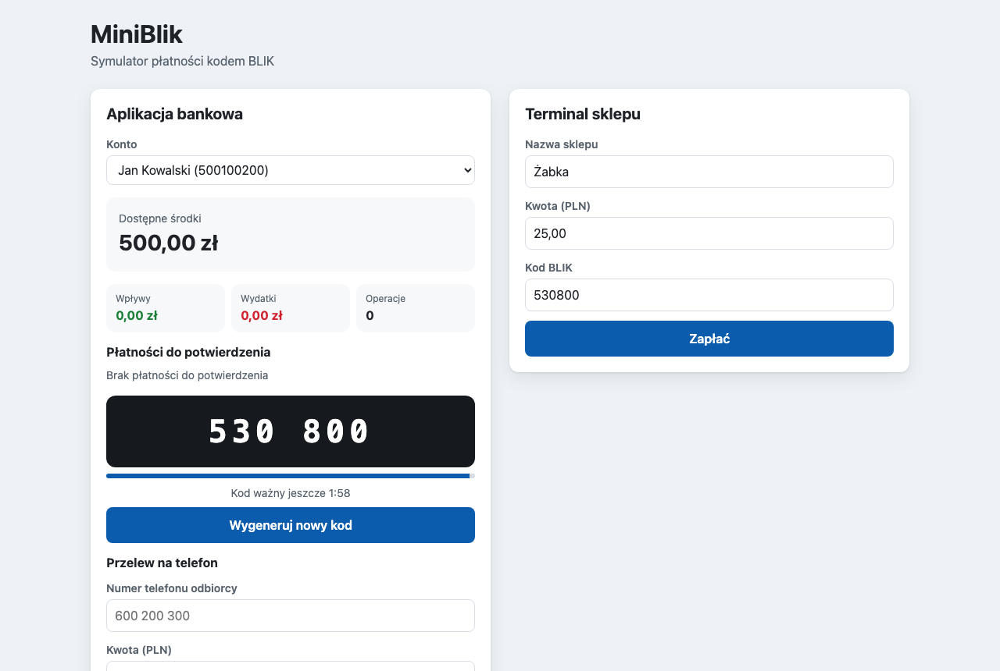
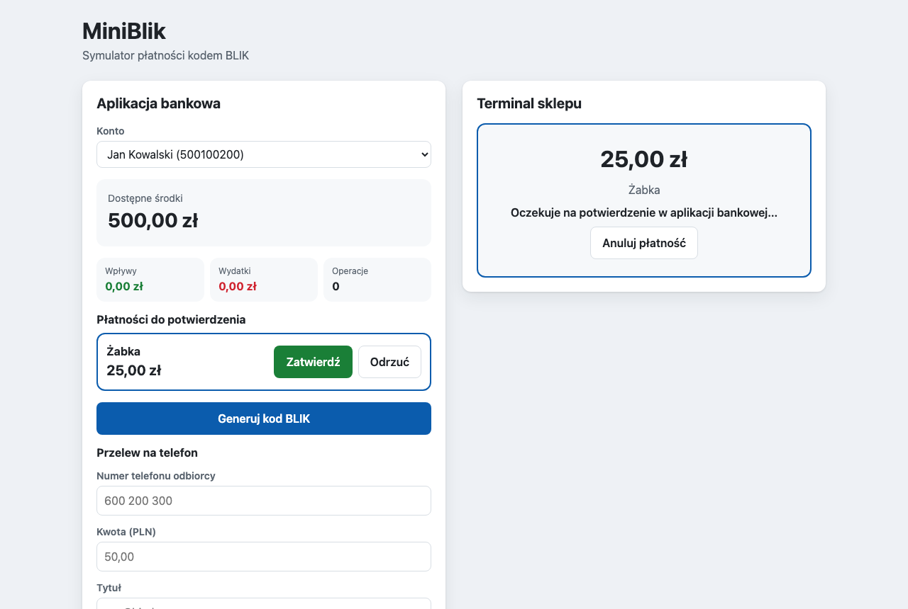
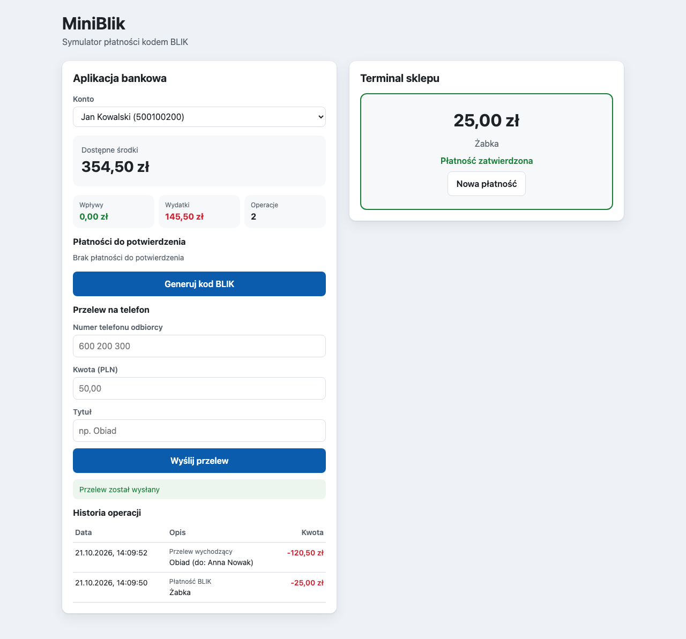

# MiniBlik – symulator płatności BLIK

[](https://github.com/Onyy03/tijo/actions/workflows/ci.yml)

## Nazwa kursu

Testowanie i Jakość Oprogramowania II. Akademia Tarnowska, Wydział Politechniczny, Katedra Informatyki,
rok 4, semestr zimowy 2026/2027.

## Autor

Norbert Armatys, nr indeksu 37664, grupa PT2

## Temat projektu

MiniBlik – symulator płatności kodem BLIK

## Opis projektu

MiniBlik odtwarza w uproszczeniu płatność kodem BLIK. Użytkownik generuje w aplikacji bankowej
6-cyfrowy kod, sprzedawca wpisuje go w terminalu razem z kwotą, a użytkownik zatwierdza albo odrzuca
płatność w aplikacji. Oprócz tego można wysłać przelew na numer telefonu i przejrzeć historię operacji.

Aplikacja ma dwa panele, które działają obok siebie w przeglądarce:

- **Aplikacja bankowa**:
  - wybór konta i saldo,
  - generowanie kodu BLIK z odliczaniem ważności,
  - zatwierdzanie i odrzucanie płatności,
  - przelew na numer telefonu,
  - historia operacji.
- **Terminal sklepu**: płatność kodem BLIK i podgląd jej statusu (oczekuje, zatwierdzona, odrzucona,
  czas minął).

### Reguły biznesowe

| ID | Reguła |
|---|---|
| R1 | Kod ma dokładnie 6 cyfr i jest losowany kryptograficznie bezpiecznym generatorem (`secrets`). |
| R2 | Kod jest ważny 120 sekund od wygenerowania. |
| R3 | Konto ma najwyżej jeden aktywny kod. Wygenerowanie nowego kodu anuluje poprzedni. |
| R4 | Kod jest jednorazowy. Po użyciu w terminalu nie da się nim zapłacić drugi raz. |
| R5 | Kwota musi być większa od zera, mieć najwyżej 2 miejsca po przecinku i nie przekraczać 5 000,00 PLN. |
| R6 | Płatność czeka na potwierdzenie najwyżej 120 sekund. Po tym czasie nie da się jej zatwierdzić. |
| R7 | Zatwierdzenie wymaga wystarczających środków. Przy ich braku saldo się nie zmienia, a płatność dalej czeka. |
| R8 | Zatwierdzić lub odrzucić można tylko płatność, która czeka na decyzję. |
| R9 | Przelew wymaga istniejącego odbiorcy i wystarczających środków. Nie można wysłać przelewu na własny numer. Kwota według R5. |
| R10 | Każda zmiana salda dodaje wpis do historii operacji. |

### Konta demonstracyjne

Przy pierwszym uruchomieniu tworzą się konta demonstracyjne:

| Właściciel | Telefon | Saldo |
|---|---|---|
| Jan Kowalski | 500100200 | 500,00 PLN |
| Anna Nowak | 600200300 | 1 500,00 PLN |
| Piotr Zieliński | 700300400 | 0,00 PLN |

### Zrzuty ekranu

Wygenerowany kod BLIK i terminal sklepu przed płatnością:



Płatność czeka na potwierdzenie w aplikacji bankowej:



Po zatwierdzeniu płatności i wysłaniu przelewu na telefon (saldo i historia operacji):



## Uruchomienie projektu

Wymagania: Python 3.12+ i Node.js 22+.

Backend (API na porcie 5001):

```bash
cd backend
python3 -m venv .venv
source .venv/bin/activate
pip install -r requirements-dev.txt
flask --app app run --port 5001
```

Frontend (w drugim terminalu):

```bash
cd frontend
npm install
npm run dev
```

| Adres | Co jest pod nim |
|---|---|
| http://localhost:5173 | aplikacja |
| http://localhost:5001/api/docs | dokumentacja API (Swagger UI) |

Baza SQLite leży w `backend/instance/miniblik.db`. Żeby wrócić do danych startowych, usuń ten plik
i uruchom backend ponownie.

## Testy

Testy backendu są w katalogu [`backend/tests`](backend/tests). Razem jest 62 przypadków testowych,
a pokrycie kodu wynosi 100%.

| Rodzaj | Liczba | Katalog | Co sprawdzają |
|---|---|---|---|
| Jednostkowe | 42 przypadki (34 funkcje testowe, część z kilkoma zestawami danych) | [`backend/tests/unit`](backend/tests/unit) | Logikę domeny i serwisów w izolacji, bez Flaska i bazy danych. Zależności zastępują fałszywe repozytoria, stały zegar i generator kodów z listy ([`tests/fakes.py`](backend/tests/fakes.py)). |
| Integracyjne | 20 | [`backend/tests/integration`](backend/tests/integration) | Całe API przez klienta testowego Flaska, z prawdziwą bazą SQLite w pamięci. Każdy test dostaje świeżą aplikację z kontami demonstracyjnymi. Upływ czasu symuluje zegar, który można przesuwać ([`conftest.py`](backend/tests/integration/conftest.py)). |

### Konwencja

- Każdy test ma budowę **Given-When-Then**: sekcje `# given`, `# when`, `# then`.
- Nazwa testu ma postać `test_should_<oczekiwany efekt>_when_<warunek>`.
- Logika domeny powstawała metodą TDD. W historii commitów test (`test(...)`) jest przed kodem, który
  go spełnia (`feat(...)`).

```python
def test_should_reject_withdrawal_when_balance_is_insufficient():
    # given
    account = create_account(balance_cents=1000)

    # when
    with pytest.raises(BusinessError) as error:
        account.withdraw(2500)

    # then
    assert error.value.code == ErrorCode.INSUFFICIENT_FUNDS
    assert account.balance_cents == 1000
```

### Uruchamianie

```bash
cd backend
source .venv/bin/activate
pytest                    # wszystkie testy
pytest tests/unit         # tylko jednostkowe
pytest tests/integration  # tylko integracyjne
pytest --cov              # z raportem pokrycia (wymagane minimum 95%)
```

Te same testy uruchamia GitHub Actions ([`.github/workflows/ci.yml`](.github/workflows/ci.yml)) przy
każdym pushu na `main` i `develop` oraz przy każdym pull requeście.

### Testy jednostkowe

Kody BLIK: [`test_code_generator.py`](backend/tests/unit/test_code_generator.py),
[`test_blik_code.py`](backend/tests/unit/test_blik_code.py),
[`test_blik_code_service.py`](backend/tests/unit/test_blik_code_service.py)

- [`test_should_generate_code_made_of_exactly_six_digits`](backend/tests/unit/test_code_generator.py#L8): generator zawsze zwraca 6 cyfr (100 losowań).
- [`test_should_be_active_before_lifetime_passes`](backend/tests/unit/test_blik_code.py#L8): kod jest aktywny 119 s po wygenerowaniu.
- [`test_should_be_inactive_after_lifetime_passes`](backend/tests/unit/test_blik_code.py#L19): po 120 s kod jest nieaktywny.
- [`test_should_be_inactive_when_cancelled`](backend/tests/unit/test_blik_code.py#L30): anulowany kod jest nieaktywny.
- [`test_should_set_expiry_to_120_seconds_after_generation`](backend/tests/unit/test_blik_code_service.py#L30): nowy kod jest ważny do „teraz + 120 s” i trafia do repozytorium.
- [`test_should_cancel_previous_active_code_when_generating_new_one`](backend/tests/unit/test_blik_code_service.py#L44): nowy kod anuluje poprzedni.
- [`test_should_draw_again_when_generated_code_is_already_in_use`](backend/tests/unit/test_blik_code_service.py#L56): kod zajęty przez inne konto jest losowany ponownie.
- [`test_should_give_up_when_every_drawn_code_is_already_in_use`](backend/tests/unit/test_blik_code_service.py#L69): po wyczerpaniu prób serwis zgłasza błąd i nic nie zapisuje.

Konto i kwoty: [`test_account.py`](backend/tests/unit/test_account.py),
[`test_amount_validator.py`](backend/tests/unit/test_amount_validator.py)

- [`test_should_decrease_balance_when_withdrawing_available_funds`](backend/tests/unit/test_account.py#L11): wypłata zmniejsza saldo.
- [`test_should_reject_withdrawal_when_balance_is_insufficient`](backend/tests/unit/test_account.py#L22): brak środków daje błąd `INSUFFICIENT_FUNDS`, a saldo się nie zmienia.
- [`test_should_reject_amount_when_it_is_not_positive`](backend/tests/unit/test_amount_validator.py#L21): kwoty `0`, `0.00` i `-5` są odrzucane.
- [`test_should_reject_amount_when_it_exceeds_limit`](backend/tests/unit/test_amount_validator.py#L33): kwota `5000.01` przekracza limit.
- [`test_should_reject_amount_when_it_has_more_than_two_decimal_places`](backend/tests/unit/test_amount_validator.py#L45): kwota `10.555` ma za dużo miejsc po przecinku.
- [`test_should_accept_amount_when_all_rules_pass`](backend/tests/unit/test_amount_validator.py#L58): kwoty `0.01`, `25.50`, `1.500` i `5000.00` przechodzą wszystkie reguły.

Płatności: [`test_payment_service.py`](backend/tests/unit/test_payment_service.py)

- [`test_should_create_pending_payment_and_mark_code_as_used_when_code_is_active`](backend/tests/unit/test_payment_service.py#L65): płatność czeka na decyzję, a kod jest oznaczony jako zużyty.
- [`test_should_reject_payment_when_code_does_not_exist`](backend/tests/unit/test_payment_service.py#L83): nieznany kod daje błąd `CODE_NOT_FOUND`.
- [`test_should_reject_payment_when_code_has_expired`](backend/tests/unit/test_payment_service.py#L95): kod starszy niż 120 s daje błąd `CODE_EXPIRED`.
- [`test_should_reject_payment_when_code_was_already_used`](backend/tests/unit/test_payment_service.py#L108): drugie użycie kodu daje błąd `CODE_NOT_ACTIVE`.
- [`test_should_keep_code_active_when_amount_is_invalid`](backend/tests/unit/test_payment_service.py#L121): błędna kwota nie zużywa kodu.
- [`test_should_withdraw_funds_and_record_history_when_payment_is_confirmed`](backend/tests/unit/test_payment_service.py#L134): zatwierdzenie pobiera środki i dodaje wpis do historii.
- [`test_should_keep_balance_and_pending_status_when_funds_are_insufficient`](backend/tests/unit/test_payment_service.py#L153): przy braku środków saldo i status płatności się nie zmieniają.
- [`test_should_reject_confirmation_when_payment_has_expired`](backend/tests/unit/test_payment_service.py#L171): po 120 s płatności nie da się zatwierdzić (`PAYMENT_EXPIRED`).
- [`test_should_mark_payment_as_rejected_without_charging_account`](backend/tests/unit/test_payment_service.py#L186): odrzucenie nie zmienia salda.
- [`test_should_reject_decision_when_payment_is_not_pending`](backend/tests/unit/test_payment_service.py#L199): rozliczonej płatności nie da się ponownie zatwierdzić ani odrzucić.
- [`test_should_raise_not_found_when_confirming_unknown_payment`](backend/tests/unit/test_payment_service.py#L212): nieznana płatność daje błąd `PAYMENT_NOT_FOUND`.

Przelewy: [`test_transfer_service.py`](backend/tests/unit/test_transfer_service.py)

- [`test_should_move_funds_and_record_both_history_entries_when_transfer_succeeds`](backend/tests/unit/test_transfer_service.py#L46): przelew zmienia oba salda i dodaje wpis w historii każdego z kont.
- [`test_should_reject_transfer_when_recipient_is_sender`](backend/tests/unit/test_transfer_service.py#L71): przelew na własny numer daje błąd `SELF_TRANSFER`.
- [`test_should_reject_transfer_when_recipient_does_not_exist`](backend/tests/unit/test_transfer_service.py#L84): nieznany numer daje błąd `RECIPIENT_NOT_FOUND`.
- [`test_should_keep_both_balances_when_sender_has_insufficient_funds`](backend/tests/unit/test_transfer_service.py#L97): przy braku środków nie zmienia się żadne saldo.
- [`test_should_reject_transfer_when_amount_is_invalid`](backend/tests/unit/test_transfer_service.py#L114): ujemna kwota jest odrzucana.

Pomocnicze: [`test_fields.py`](backend/tests/unit/test_fields.py),
[`test_clock.py`](backend/tests/unit/test_clock.py)

- [`test_should_serialize_cents_as_decimal_string`](backend/tests/unit/test_fields.py#L17): grosze są zamieniane na tekst w API (`2500` → `"25.00"`).
- [`test_should_add_utc_offset_to_datetime_from_database`](backend/tests/unit/test_fields.py#L28): daty z bazy dostają strefę UTC.
- [`test_should_keep_missing_values_empty`](backend/tests/unit/test_fields.py#L39): pusta wartość zostaje pusta.
- [`test_should_return_current_utc_time_without_timezone`](backend/tests/unit/test_clock.py#L6): zegar systemowy zwraca bieżący czas UTC.

### Testy integracyjne

Konta: [`test_accounts_api.py`](backend/tests/integration/test_accounts_api.py),
[`test_seed.py`](backend/tests/integration/test_seed.py)

- [`test_should_return_demo_accounts_when_listing_accounts`](backend/tests/integration/test_accounts_api.py#L1): `GET /api/accounts` zwraca 200 i trzy konta demonstracyjne.
- [`test_should_return_not_found_when_account_does_not_exist`](backend/tests/integration/test_accounts_api.py#L20): `GET /api/accounts/999` zwraca 404 `ACCOUNT_NOT_FOUND`.
- [`test_should_not_duplicate_demo_accounts_when_seeding_again`](backend/tests/integration/test_seed.py#L8): ponowne tworzenie danych demonstracyjnych nie dubluje kont.

Kody BLIK: [`test_blik_codes_api.py`](backend/tests/integration/test_blik_codes_api.py)

- [`test_should_create_active_six_digit_code_valid_for_120_seconds`](backend/tests/integration/test_blik_codes_api.py#L16): `POST /api/accounts/1/blik-codes` zwraca 201, 6-cyfrowy kod i datę ważności. W bazie kod ma status `ACTIVE`.
- [`test_should_cancel_previous_code_when_generating_new_one`](backend/tests/integration/test_blik_codes_api.py#L31): po wygenerowaniu drugiego kodu pierwszy ma w bazie status `CANCELLED`.

Płatności: [`test_payments_api.py`](backend/tests/integration/test_payments_api.py)

- [`test_should_create_pending_payment_when_code_is_valid`](backend/tests/integration/test_payments_api.py#L13): `POST /api/payments` zwraca 201 i status `PENDING`.
- [`test_should_return_bad_request_when_code_format_is_invalid`](backend/tests/integration/test_payments_api.py#L26): kod `12ab56` daje 400 `VALIDATION_ERROR` z komunikatem przy polu.
- [`test_should_return_not_found_when_code_does_not_exist`](backend/tests/integration/test_payments_api.py#L40): nieznany kod daje 404 `CODE_NOT_FOUND`.
- [`test_should_reject_payment_when_code_has_expired`](backend/tests/integration/test_payments_api.py#L52): po przesunięciu zegara o 121 s odpowiedź to 422 `CODE_EXPIRED`.
- [`test_should_reject_second_payment_with_the_same_code`](backend/tests/integration/test_payments_api.py#L65): drugie użycie kodu daje 422 `CODE_NOT_ACTIVE`.
- [`test_should_list_new_payment_as_pending_only_for_code_owner`](backend/tests/integration/test_payments_api.py#L78): płatność widzi do potwierdzenia tylko właściciel kodu.
- [`test_should_charge_account_and_record_history_when_payment_is_confirmed`](backend/tests/integration/test_payments_api.py#L91): zatwierdzenie zwraca 200, saldo spada do 475,00 PLN, a w historii jest nowy wpis.
- [`test_should_keep_balance_when_confirming_without_sufficient_funds`](backend/tests/integration/test_payments_api.py#L107): brak środków daje 422 `INSUFFICIENT_FUNDS`, a saldo i status płatności się nie zmieniają.
- [`test_should_mark_payment_as_rejected_without_charging_account`](backend/tests/integration/test_payments_api.py#L121): odrzucenie zwraca 200 `REJECTED` i nie zmienia salda.
- [`test_should_refuse_confirmation_when_payment_has_expired`](backend/tests/integration/test_payments_api.py#L135): po 121 s odpowiedź to 422 `PAYMENT_EXPIRED`, a płatność znika z listy do potwierdzenia.

Przelewy i historia: [`test_transfers_api.py`](backend/tests/integration/test_transfers_api.py)

- [`test_should_move_funds_between_accounts_when_transfer_is_valid`](backend/tests/integration/test_transfers_api.py#L17): `POST /api/transfers` zwraca 201, a salda wynoszą 380,00 i 1 620,00 PLN.
- [`test_should_return_not_found_when_recipient_phone_is_unknown`](backend/tests/integration/test_transfers_api.py#L32): nieznany numer daje 404 `RECIPIENT_NOT_FOUND`.
- [`test_should_show_transfer_in_history_of_both_accounts`](backend/tests/integration/test_transfers_api.py#L45): przelew widać w historii nadawcy i odbiorcy.

Dokumentacja API: [`test_openapi.py`](backend/tests/integration/test_openapi.py)

- [`test_should_publish_openapi_specification_with_all_resources`](backend/tests/integration/test_openapi.py#L1): `/api/openapi.json` zawiera wszystkie zasoby.
- [`test_should_serve_swagger_ui_page`](backend/tests/integration/test_openapi.py#L22): strona Swagger UI odpowiada pod `/api/docs`.

### Analiza statyczna kodu

```bash
cd backend && ruff check . && ruff format --check .   # m.in. nieużywane importy (F401) i nazewnictwo (N)
cd frontend && npm run lint                           # oxlint, m.in. nieużywane zmienne i importy
```

## Technologie użyte w projekcie

- Backend: Python, Flask, Flask-SQLAlchemy (SQLite), flask-smorest (OpenAPI / Swagger UI)
- Frontend: React, Vite
- Testy i jakość: pytest, ruff, oxlint
